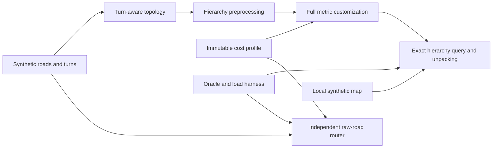

# WayglassArc

Offline turn-aware road routing. Find an exact legal route through fictional roads, restrictions and closures, then explain its original segments and costs. Acceleration must preserve legality and one immutable traffic profile throughout the query.

**Stage:** requirements and design baseline, 25 November 2026. Product code, benchmark results and runtime acceptance are not delivered or claimed.

Turn-aware states distinguish incoming road direction. Topology preprocessing, full metric customization, exact search and shortcut unpacking are separate stages. No external map or routing library supplies answers.

Start with the [documentation guide](docs/README.md), [product scope](docs/requirements/product.md), [high-level design](docs/architecture/high-level-design.md) and [component designs](docs/design/README.md).

[JSON Schemas](schemas/README.md) and [worked examples](examples/README.md) accompany the protocol/data design. Numerical/graph/bytecode artifacts use explicit versioned formats; no unnecessary database dependency is introduced.

Reference direction: C++20 with checked 64-bit costs, standard containers/binary artifact I/O, a permitted local HTTP adapter, and HTML/CSS/JavaScript with SVG or Canvas 2D. Exact dependencies require environment inventory.

Public repository; [MIT license](LICENSE). [Original input](docs/source/README.md) remains archived. Documentation is AI-assisted; participant-authored submissions and programme approval are separate assessments.
