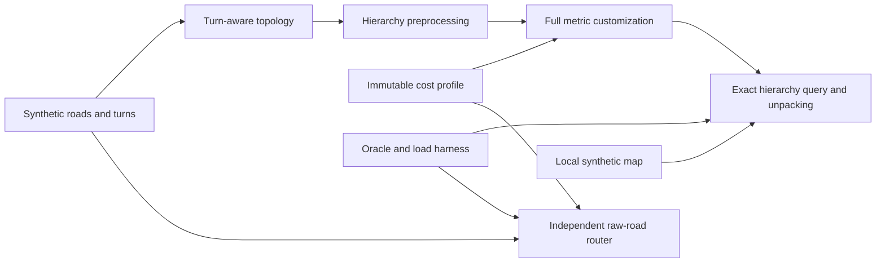

# High-level design

Find an exact legal route through fictional roads, restrictions and closures, then explain its original segments and costs. Acceleration must preserve legality and one immutable traffic profile throughout the query.

## Core and presentation boundary



Turn-aware states distinguish incoming road direction. Topology preprocessing, full metric customization, exact search and shortcut unpacking are separate stages. No external map or routing library supplies answers.

The headless core performs every algorithm and mandatory benchmark without a browser. UI/API adapters serialize bounded state and controls. Inputs, configuration, build and seeds identify each reproducible experiment.

## Main execution sequence

```mermaid
sequenceDiagram
    participant I as Importer
    participant H as Hierarchy builder
    participant C as Customizer
    participant Q as Query
    participant V as Independent checker
    I->>H: All physical connected turn pairs
    H->>H: Deterministic order and complete fill skeleton
    H->>C: Directed hierarchy and topology hash
    C->>C: Full profile weights and acyclic witnesses
    C->>Q: Atomically publish verified artifact
    Q->>Q: Pin topology and profile digest
    Q->>Q: Upward searches; exact shortcut unpack
    Q->>V: Original segment IDs and cost
    V->>V: Check legal turns and recompute cost
```

## Components

| Component | Responsibility |
| --- | --- |
| [Network import and checked cost semantics](../design/import.md) | Validate stable directed segment identities, finite geometry and explicit endpoint connectivity. |
| [Turn-aware topology and boundary seeding](../design/expansion.md) | Create one routing state per incoming directed segment. |
| [Deterministic elimination order and fill topology](../design/hierarchy.md) | Construct an undirected adjacency skeleton from the directed expanded topology while preserving directional metric slots. |
| [Full directional weights and witness construction](../design/customization.md) | Bind one complete profile digest to one topology hash and initialize directional original transition weights. |
| [Exact upward search and stable query profiles](../design/queries.md) | Pin an immutable complete topology/profile artifact pair for search and unpacking. |
| [Shortcut unpacking and original-route explanation](../design/unpacking.md) | Expand witness dependencies with rank/cycle and work bounds. |
| [Exact network reachability and immutable artifact lifetime](../design/reachable.md) | Search raw turn-aware states to the inclusive integer travel budget. |

## Qualification

Preprocessing <=10 minutes and <=2 GiB; full customization <=10 seconds/profile; >=100 accelerated full routes/s for 60 seconds with p95 <=500 ms; median core-search speedup >=3x on 1,000 frozen long-distance pairs. Exactness: 10,000 cases and 200 small graphs.

50,000 intersections, approximately 150,000 directed segments, <=200,000 turn states and <=600,000 transitions. Base/peak/closure profiles and a frozen 60% cross-district, 20% local, 10% closure-affected, 10% disconnected pair mix.

Frozen workloads and independent oracles remain mandatory. Faster-looking rendering or weaker semantics do not satisfy the quantitative bar.
