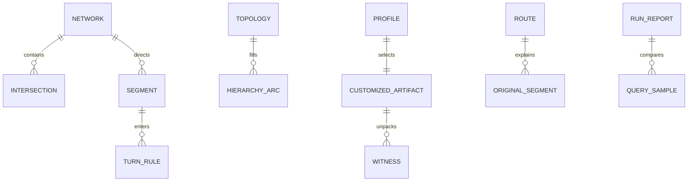

# Artifact storage identity and publication

The [format specification](../../formats/README.md) defines versioning, provenance and checksums. These projects need immutable files/owned memory, not an invented mandatory database.

Build a new artifact in a controlled staging location, complete its payload, close/flush using documented host guarantees, verify checksums/structure and atomically select it through a small manifest or supported same-filesystem rename. Record what is and is not guaranteed under process stop versus power loss. Partial files never replace a valid selected artifact.

Topology/profile/customization hashes must agree. Queries hold immutable artifact references through search/unpack; cleanup waits for all references. Witness cycles/mismatches fail before returning a route.

Malformed versions, truncated payloads, path escapes and inconsistent identities are explicit errors. Cleanup has finite retained-count/byte limits and preserves active/pinned artifacts and raw failure reports. No regeneration command overwrites executed evidence.
