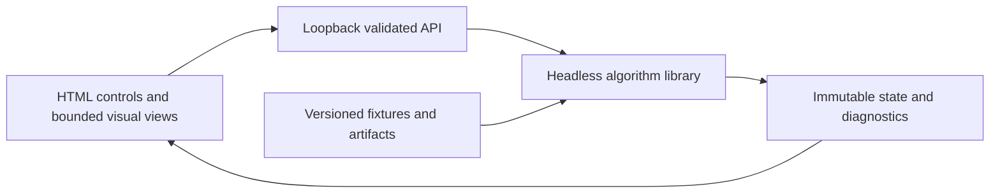

# Browser and local API modules

Use small modules for API, exact identity/state, controls, visualization and inspector pagination. Painting/culling/editor changes never alter core algorithm ordering or results. Local controllers enforce finite tick/query/instruction work per request and expose cancellation at safe boundaries.

## Browser map and analysis UI

Build a local HTML/CSS/JavaScript interface, optionally using locally compiled TypeScript. Render synthetic road geometry with SVG or Canvas 2D; no external tiles, fonts, map SDK, WebGL, or GPU compute is required. Software rendering must remain functional.

Required features: pan/zoom; source/destination intersection selection; profile selection; route display; segment and turn-cost breakdown; prohibited-turn overlay; closures; reachable-budget visualization; hierarchy search exploration on bounded fixtures; profile customization progress; oracle comparison; and benchmark report viewer.

Display profile/version, total cost, mode, settled states, and path length. Selecting a turn shows why it is allowed or prohibited. A geometry crossing without a junction must look distinguishable. An unreachable result stays visibly different from a successful zero-cost route.

Use viewport culling or local levels of detail rather than drawing every segment on every pointer move. Route correctness cannot depend on the visual simplification. Keyboard controls, text descriptions, bounded inspectors, and clear loading/error states are required.

All mutation/control replies identify the accepted run/artifact and source revision. Handle errors and stale state visibly. Requests are not retried as fresh intent after an unknown outcome; stable control identity/status resolves uncertainty where needed. The future UI must call actual core APIs; this repository supplies its design, not fabricated progress.
