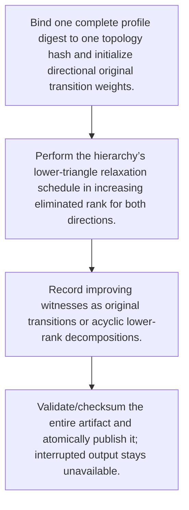

# Full directional weights and witness construction

Full customization is required after every profile change. Equal-weight ties follow a stable rule without introducing self/cyclic witnesses. Closures and one-way asymmetry remain directional. The exact reviewed algorithm/pseudocode and invariant tests precede implementation; no shortcut-edit heuristic replaces them.

## Algorithm

1. Bind one complete profile digest to one topology hash and initialize directional original transition weights.
2. Perform the hierarchy’s lower-triangle relaxation schedule in increasing eliminated rank for both directions.
3. Record improving witnesses as original transitions or acyclic lower-rank decompositions.
4. Validate/checksum the entire artifact and atomically publish it; interrupted output stays unavailable.

## Interface and ownership

Inputs are validated immutable domain data plus exact configuration/run/artifact identity. The component returns bounded results or a structured diagnostic with reproducible provenance. No UI action bypasses core validation. [API](../contracts/api.md), [artifact contracts](../contracts/data-and-artifacts.md) and [formats](../../formats/README.md) define the boundary.

## Required behavior

## Customization and shortcut witnesses

Customization starts from original transition costs and computes the required hierarchy weights for one exact profile digest. Closures are unavailable/infinite transitions. A weight change can affect shortcuts far from the changed road; editing only that road's hierarchy arc is not sufficient.

For the first release, fully customize each new profile. Local incremental customization is deferred. Retain enough witness information to unpack every selected shortcut into legal original transitions. Witness dependencies must be acyclic under the algorithm's ordering.

Tie handling is deterministic. Expanded paths are checked against the original roads and the selected profile. Corrupt or cyclic witness references must be rejected rather than looping or returning truncated geometry.

Publish a profile's customized artifact only after structural validation completes. An interrupted customization leaves the prior artifact usable and the new profile unavailable or explicitly reference-only. The artifact format is versioned and checksummed.

## Failure and verification

Partial artifacts never become selected outputs. Numerical/resource/cost/bytecode errors preserve their fixture and location rather than fabricate a plausible answer. Independent oracles must not call the production implementation being evaluated. See [harness and fixtures](../testing/harness-and-fixtures.md) and [acceptance](../testing/acceptance-plan.md). All runtime outcomes remain NOT RUN.
