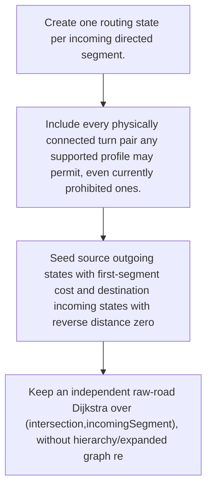

# Turn-aware topology and boundary seeding

Prohibited turns have infinite transition cost; allowed transitions add outgoing segment cost plus turn penalty. Same-source/target is the special empty route. Lifting a restriction within existing physical topology needs customization, not missing state creation.

## Algorithm

1. Create one routing state per incoming directed segment.
2. Include every physically connected turn pair any supported profile may permit, even currently prohibited ones.
3. Seed source outgoing states with first-segment cost and destination incoming states with reverse distance zero.
4. Keep an independent raw-road Dijkstra over (intersection,incomingSegment), without hierarchy/expanded graph reuse.

## Interface and ownership

Inputs are validated immutable domain data plus exact configuration/run/artifact identity. The component returns bounded results or a structured diagnostic with reproducible provenance. No UI action bypasses core validation. [API](../contracts/api.md), [artifact contracts](../contracts/data-and-artifacts.md) and [formats](../../formats/README.md) define the boundary.

## Required behavior

## Turn-aware state expansion

A search state represents arriving via a directed segment. The topology contains all physically connected incoming/outgoing turn pairs that profiles may permit, including pairs currently prohibited. A profile gives prohibited turns infinite cost and permitted turns the outgoing segment cost plus turn penalty. This distinguishes reaching an intersection from different directions and allows a restriction to be lifted without inventing a missing hierarchy transition. A newly introduced physical connection outside this topology requires preprocessing again.

For a source intersection, seed its outgoing segment states with their segment travel costs. For a destination, accept any state whose segment ends there. Equivalent virtual source/sink arcs are allowed if zero-cost handling and path reconstruction are correct. Preserve source/destination boundary semantics in all accelerated queries.

The independent reference router must operate directly on the original roads and `(intersection, incoming_segment)` states. It must not consume the engine's expanded graph, hierarchy, shortcuts, or witness data. This catches graph-expansion bugs as well as query bugs.

## Failure and verification

Partial artifacts never become selected outputs. Numerical/resource/cost/bytecode errors preserve their fixture and location rather than fabricate a plausible answer. Independent oracles must not call the production implementation being evaluated. See [harness and fixtures](../testing/harness-and-fixtures.md) and [acceptance](../testing/acceptance-plan.md). All runtime outcomes remain NOT RUN.
