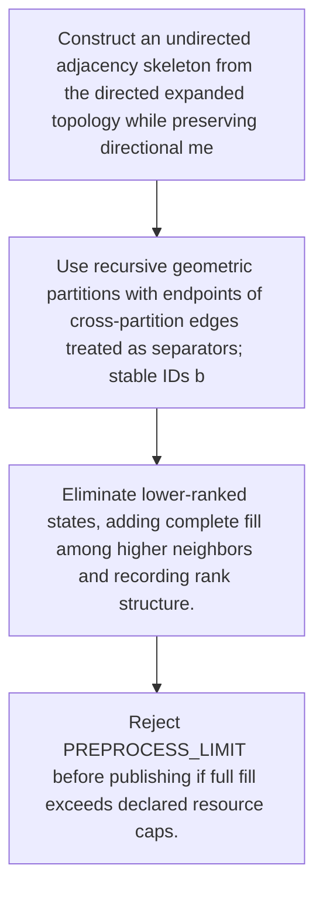

# Deterministic elimination order and fill topology

Nonplanar bridge connectors may worsen ordering but cannot be omitted. If a separator consumes the entire component, fall back to a deterministic ordering and report quality. Correctness needs complete shortcut preservation, not a claim that geometric partitions are always small.

## Algorithm

1. Construct an undirected adjacency skeleton from the directed expanded topology while preserving directional metric slots.
2. Use recursive geometric partitions with endpoints of cross-partition edges treated as separators; stable IDs break ties.
3. Eliminate lower-ranked states, adding complete fill among higher neighbors and recording rank structure.
4. Reject PREPROCESS_LIMIT before publishing if full fill exceeds declared resource caps.

## Interface and ownership

Inputs are validated immutable domain data plus exact configuration/run/artifact identity. The component returns bounded results or a structured diagnostic with reproducible provenance. No UI action bypasses core validation. [API](../contracts/api.md), [artifact contracts](../contracts/data-and-artifacts.md) and [formats](../../formats/README.md) define the boundary.

## Required behavior

## Mandatory hierarchy algorithm

Implement a documented customizable contraction hierarchy or an equivalently exact metric-customizable hierarchy. For the intended design, derive an elimination order from topology, construct the shortcut/fill structure, and customize directional arc weights using the selected metric.

Use a deterministic topology ordering, with nested geometric partitioning plus explicit separator handling suitable for the synthetic networks. It must remain correct for nonplanar bridge edges and disconnected components even if ordering quality worsens. Record order quality, hierarchy size, preprocessing cost, and memory.

Implement the algorithm from reviewed pseudocode with proof obligations for shortcut preservation and query termination. A path through eliminated states must remain representable. If a preprocessing resource cap is exceeded, return `PREPROCESS_LIMIT`; do not omit necessary shortcuts and continue with an approximate answer.

Both forward and backward directional costs are required for directed roads. A convenient undirected representation cannot erase one-way restrictions.

## Failure and verification

Partial artifacts never become selected outputs. Numerical/resource/cost/bytecode errors preserve their fixture and location rather than fabricate a plausible answer. Independent oracles must not call the production implementation being evaluated. See [harness and fixtures](../testing/harness-and-fixtures.md) and [acceptance](../testing/acceptance-plan.md). All runtime outcomes remain NOT RUN.
