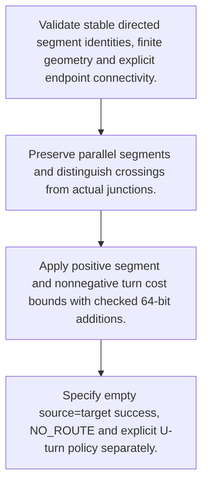

# Network import and checked cost semantics

The reference reserves INT64_MAX/4 as infinity and rejects finite additions reaching/exceeding that sentinel. Closures are tagged unavailable rather than a falsely cheap numeric zero. Geometry does not affect metric cost unless the declared generator/profile explicitly uses it.

## Algorithm

1. Validate stable directed segment identities, finite geometry and explicit endpoint connectivity.
2. Preserve parallel segments and distinguish crossings from actual junctions.
3. Apply positive segment and nonnegative turn cost bounds with checked 64-bit additions.
4. Specify empty source=target success, NO_ROUTE and explicit U-turn policy separately.

## Interface and ownership

Inputs are validated immutable domain data plus exact configuration/run/artifact identity. The component returns bounded results or a structured diagnostic with reproducible provenance. No UI action bypasses core validation. [API](../contracts/api.md), [artifact contracts](../contracts/data-and-artifacts.md) and [formats](../../formats/README.md) define the boundary.

## Required behavior

## Network and metric contracts

| Entity | Required fields |
| --- | --- |
| Intersection | stable ID, synthetic planar coordinates |
| Directed segment | stable ID, from/to intersections, polyline, positive travel cost, optional class |
| Turn rule | incoming segment, outgoing segment, allowed/prohibited, nonnegative penalty |
| Topology artifact | input hash, ordering, expanded graph, hierarchy arcs, format version |
| Metric profile | ID/version, topology hash, segment costs, turn costs/closures, digest |
| Customized hierarchy | topology hash, exact profile digest, directional weights, witnesses |
| Route | profile/version, original segment sequence, total segment/turn costs, status |
| Report | seed, graph/profile digests, build, comparisons, errors, timings |

Travel costs are integer milliseconds from 1 to 1,000,000,000 per segment. Turn penalties range from zero to 1,000,000 ms. Checked 64-bit accumulation uses a documented infinity sentinel. Overflow returns an explicit error; it cannot produce a falsely cheap route.

Reject invalid endpoints, duplicate segment IDs, nonfinite coordinates, negative costs, malformed turn connectivity, and inconsistent profile/topology hashes. Parallel segments remain distinct. Geometry crossings do not create connections unless an intersection is explicitly present.

## Exact route semantics

The cost of a segment sequence is the first segment's travel cost plus, for each later segment, its travel cost and the penalty for entering it from the previous segment. Every consecutive pair must connect and have an allowed turn. A closed segment or prohibited turn makes that traversal unavailable.

The first segment has no incoming-turn penalty. A route from an intersection to itself is the empty zero-cost route. An unreachable destination returns `NO_ROUTE`, not an empty successful path. U-turns follow explicit policy/rules; never assume that returning to the previous intersection is automatically allowed.

Any minimum-cost legal route is acceptable. Stable input and configuration must select a reproducible route, but the accelerated and reference algorithms need not select the same path when several paths tie. Compare exact total cost and independent legality in that case. Do not require global lexicographic path minimality unless a separate algorithm implements it.

## Failure and verification

Partial artifacts never become selected outputs. Numerical/resource/cost/bytecode errors preserve their fixture and location rather than fabricate a plausible answer. Independent oracles must not call the production implementation being evaluated. See [harness and fixtures](../testing/harness-and-fixtures.md) and [acceptance](../testing/acceptance-plan.md). All runtime outcomes remain NOT RUN.
