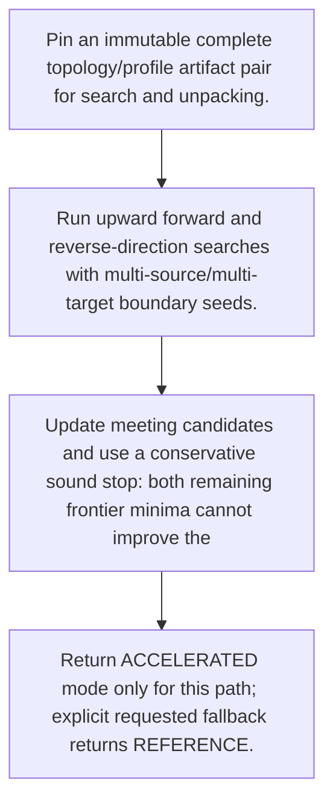

# Exact upward search and stable query profiles

Use the reviewed hierarchy termination proof; do not casually reuse a sum-of-frontiers stop from an unrestricted graph search. If one frontier empties, continue the other while it can improve a meeting. All timings include required path unpacking/serialization in end-to-end metrics.

## Algorithm

1. Pin an immutable complete topology/profile artifact pair for search and unpacking.
2. Run upward forward and reverse-direction searches with multi-source/multi-target boundary seeds.
3. Update meeting candidates and use a conservative sound stop: both remaining frontier minima cannot improve the best candidate.
4. Return ACCELERATED mode only for this path; explicit requested fallback returns REFERENCE.

## Interface and ownership

Inputs are validated immutable domain data plus exact configuration/run/artifact identity. The component returns bounded results or a structured diagnostic with reproducible provenance. No UI action bypasses core validation. [API](../contracts/api.md), [artifact contracts](../contracts/data-and-artifacts.md) and [formats](../../formats/README.md) define the boundary.

## Required behavior

## Accelerated query and fallback contract

Use the hierarchy's exact upward/bidirectional query procedure and a sound stopping condition. Track settled states, relaxed arcs, meeting state, and unpacking cost. Tests must challenge premature termination with asymmetric and disconnected cases.

Every query selects one immutable topology/profile pair at invocation and returns its identity. The entire distance search and unpacking use that pair. A newly published profile affects subsequent queries, not an in-flight route.

If a profile has not been customized, the API may offer an explicitly requested reference fallback. It must identify `REFERENCE` mode. Accelerated benchmark results cannot include hidden fallback queries or claim fallback throughput as hierarchy throughput.

## Failure and verification

Partial artifacts never become selected outputs. Numerical/resource/cost/bytecode errors preserve their fixture and location rather than fabricate a plausible answer. Independent oracles must not call the production implementation being evaluated. See [harness and fixtures](../testing/harness-and-fixtures.md) and [acceptance](../testing/acceptance-plan.md). All runtime outcomes remain NOT RUN.
