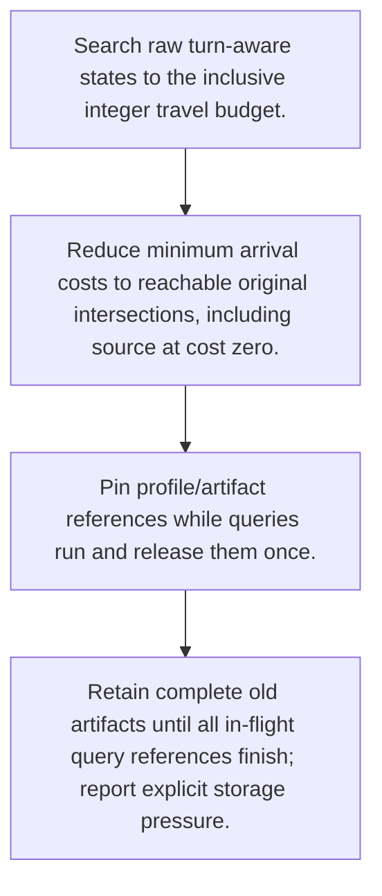

# Exact network reachability and immutable artifact lifetime

Reachability may use an exact reference-style search and is labeled separately from accelerated point-to-point benchmarks. Its map colors a network set, not an exact continuous geographic polygon. Visual culling does not change topology or cost.

## Algorithm

1. Search raw turn-aware states to the inclusive integer travel budget.
2. Reduce minimum arrival costs to reachable original intersections, including source at cost zero.
3. Pin profile/artifact references while queries run and release them once.
4. Retain complete old artifacts until all in-flight query references finish; report explicit storage pressure.

## Interface and ownership

Inputs are validated immutable domain data plus exact configuration/run/artifact identity. The component returns bounded results or a structured diagnostic with reproducible provenance. No UI action bypasses core validation. [API](../contracts/api.md), [artifact contracts](../contracts/data-and-artifacts.md) and [formats](../../formats/README.md) define the boundary.

## Required behavior

## Reachable-area analysis

Given source, profile, and travel budget, compute the exact set of reachable intersections and minimum arrival cost using a turn-aware search. For the first release this may use the reference-style exact search rather than the accelerated point-to-point procedure.

The UI colors reachable intersections and roads with clear budget labels. It must not claim a mathematically exact geographic polygon between roads. Reachability is defined on the network. Test budget equality, prohibited turns, one-way return paths, and closures.

This feature exercises whole-region computation and makes routing restrictions visible without turning the project into a map-service wrapper.

## Local APIs and artifacts

Suggested operations: generate/import network, validate topology, preprocess hierarchy, create/customize profile, inspect artifact, query route, compute reachable set, compare against reference, run benchmark, and retrieve report.

Suggested routes are `POST /networks`, `POST /networks/{id}/preprocess`, `POST /profiles`, `POST /profiles/{id}/customize`, `POST /routes`, `POST /reachable`, `GET /artifacts/{id}`, and `GET /reports/{id}`. Each response includes immutable input identity and execution mode.

Bound request size, profile count, queued queries, reachable-set size, route length, artifact bytes, and inspection pages. A route beyond a response limit returns an explicit limit result or a paginated artifact with total cost; it is never silently truncated. Distinguish invalid input, no route, unavailable profile, incompatible artifact, resource limit, and internal error.

The service binds to loopback. File import operates on synthetic local files. No map provider, location permission, network tile request, or external process control is required.

## Failure and verification

Partial artifacts never become selected outputs. Numerical/resource/cost/bytecode errors preserve their fixture and location rather than fabricate a plausible answer. Independent oracles must not call the production implementation being evaluated. See [harness and fixtures](../testing/harness-and-fixtures.md) and [acceptance](../testing/acceptance-plan.md). All runtime outcomes remain NOT RUN.
