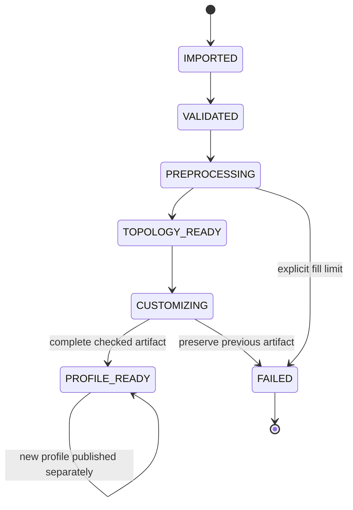

# Run and artifact state machines

A UI label cannot turn a failed run or incomplete artifact into a completed result. Every action carries current run/build/profile identity. Restart/restore uses the documented boundary rather than guessing old handles or silently replacing the artifact.

A previously published profile remains usable during customization of another. Requested reference fallback is explicitly labeled and excluded from hierarchy benchmarks.
