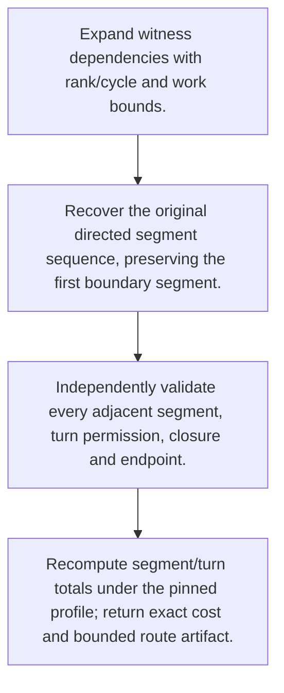

# Shortcut unpacking and original-route explanation

Different legal equal-cost paths are acceptable between reference and hierarchy. A broken/cyclic witness is an artifact error, never a truncated successful route. Route length limits return an explicit error or paginated complete artifact with total cost.

## Algorithm

1. Expand witness dependencies with rank/cycle and work bounds.
2. Recover the original directed segment sequence, preserving the first boundary segment.
3. Independently validate every adjacent segment, turn permission, closure and endpoint.
4. Recompute segment/turn totals under the pinned profile; return exact cost and bounded route artifact.

## Interface and ownership

Inputs are validated immutable domain data plus exact configuration/run/artifact identity. The component returns bounded results or a structured diagnostic with reproducible provenance. No UI action bypasses core validation. [API](../contracts/api.md), [artifact contracts](../contracts/data-and-artifacts.md) and [formats](../../formats/README.md) define the boundary.

## Required behavior

## Customization and shortcut witnesses

Customization starts from original transition costs and computes the required hierarchy weights for one exact profile digest. Closures are unavailable/infinite transitions. A weight change can affect shortcuts far from the changed road; editing only that road's hierarchy arc is not sufficient.

For the first release, fully customize each new profile. Local incremental customization is deferred. Retain enough witness information to unpack every selected shortcut into legal original transitions. Witness dependencies must be acyclic under the algorithm's ordering.

Tie handling is deterministic. Expanded paths are checked against the original roads and the selected profile. Corrupt or cyclic witness references must be rejected rather than looping or returning truncated geometry.

Publish a profile's customized artifact only after structural validation completes. An interrupted customization leaves the prior artifact usable and the new profile unavailable or explicitly reference-only. The artifact format is versioned and checksummed.

## Correctness, metamorphic tests, and interruption cases

Compare every sampled route cost with the independent raw-road router. Recalculate path cost from original segment IDs, verify every adjacency/turn, and check endpoint identity. For tied paths, accept different legal paths with equal optimal cost.

Metamorphic checks: increasing one road's cost cannot lower the optimal cost; removing a restriction cannot worsen it; closing a road absent from an existing optimal route leaves that route available and its optimal cost unchanged; splitting a road into two compatible segments with identical total cost and preserved endpoint turn rules preserves relevant distances between original intersections; translating/rotating geometry leaves costs unchanged.

Interrupt artifact creation before publication, during checksum generation, and before response. Loading a truncated or mismatched artifact must fail clearly. Run queries while another profile is customized and verify that every response uses one complete profile. Keep all failed seeds and concrete counterexample paths.

## Failure and verification

Partial artifacts never become selected outputs. Numerical/resource/cost/bytecode errors preserve their fixture and location rather than fabricate a plausible answer. Independent oracles must not call the production implementation being evaluated. See [harness and fixtures](../testing/harness-and-fixtures.md) and [acceptance](../testing/acceptance-plan.md). All runtime outcomes remain NOT RUN.
