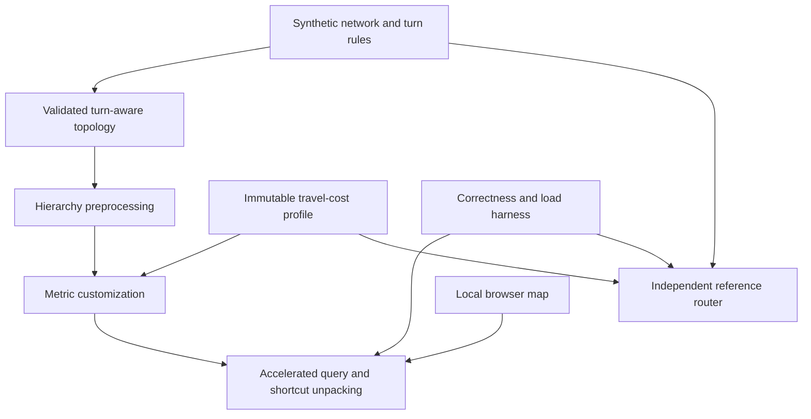

# WayglassArc — Offline Turn-Aware Road-Routing Engine

Version 1.0 · 25 November 2026 · Proposed requirements. Implementation, benchmark results, and acceptance tests are not yet complete or claimed.

## 1. Purpose

Build an offline routing engine that finds exact shortest legal routes through a large synthetic road network, including one-way streets, prohibited turns, turn penalties, closures, and changing travel-cost profiles. It must accelerate queries with its own hierarchical graph algorithms, reconstruct real road segments from shortcuts, and explain each result in a local browser map.

The intended users are engineers interested in geographic algorithms and developers building routing tools. The hard problem is making the accelerated answer remain exactly correct when a superficially shorter path contains an illegal turn or uses shortcut costs computed for another traffic profile. A line drawn across a map is not enough: its legality and total cost must be independently checkable.

This is geographic graph-algorithm work. It does not extend earlier workflow, messaging, reservation, gateway, synchronization, consensus, streaming, or database-index projects. Its core is shortest-path computation and turn-aware hierarchy construction, not service traffic routing or index migration.

## 2. Ownership and program status

This document is an AI-assisted reference proposal, not evidence of independent participant origination or program approval. The supplied rules exclude AI-invented projects and require participants' own submission answers. Resolve eligibility with the project contact before submitting; program development sessions start only after approval.

Use generated roads and fictional places. No real location histories, personal addresses, employer datasets, private telemetry, map-service account, API key, production system, or AI model infrastructure is needed. No claim of real navigation safety or real-world traffic accuracy is made.

## 3. End state

Deliver a synthetic road-network generator, validated graph importer, turn-aware graph model, independent reference router, topology preprocessing, metric customization, accelerated exact query engine, shortcut unpacker, reachable-area analysis, browser map, CLI/API, correctness campaign, and benchmark report.

Implement the routing core. An existing routing service, GIS package, graph-routing library, or precomputed route dataset cannot provide the actual answers. Standard libraries may supply JSON, containers, HTTP, sorting, and basic drawing.

The release is complete when routes are exact and legal across the mandatory fixtures and load campaigns, hierarchy speedup is measured against a reference, and metric changes cannot silently mix incompatible costs.

## 4. Required scope and exclusions

Required: directed roads; parallel segments; disconnected components; explicit turn restrictions/costs; exact nonnegative integer-cost routing; path reconstruction; hierarchical acceleration; at least three cost profiles; closure updates; immutable per-query profile selection; route explanation; travel-budget reachable sets; and offline map inspection.

Deferred: real GPS, online traffic ingestion, real-world addresses/geocoding, transit schedules, fleet assignment, vehicle routing with many stops, arbitrary topology changes without preprocessing, continuous time-dependent travel functions, and continent-scale capacity claims.

Travel costs are fixed for the whole query. A new profile represents a different snapshot of conditions. The engine does not model changing traffic while a vehicle is already traveling. This explicit boundary keeps exactness testable.

## 5. Network and metric contracts

| Entity | Required fields |
| --- | --- |
| Intersection | stable ID, synthetic planar coordinates |
| Directed segment | stable ID, from/to intersections, polyline, positive travel cost, optional class |
| Turn rule | incoming segment, outgoing segment, allowed/prohibited, nonnegative penalty |
| Topology artifact | input hash, ordering, expanded graph, hierarchy arcs, format version |
| Metric profile | ID/version, topology hash, segment costs, turn costs/closures, digest |
| Customized hierarchy | topology hash, exact profile digest, directional weights, witnesses |
| Route | profile/version, original segment sequence, total segment/turn costs, status |
| Report | seed, graph/profile digests, build, comparisons, errors, timings |

Travel costs are integer milliseconds from 1 to 1,000,000,000 per segment. Turn penalties range from zero to 1,000,000 ms. Checked 64-bit accumulation uses a documented infinity sentinel. Overflow returns an explicit error; it cannot produce a falsely cheap route.

Reject invalid endpoints, duplicate segment IDs, nonfinite coordinates, negative costs, malformed turn connectivity, and inconsistent profile/topology hashes. Parallel segments remain distinct. Geometry crossings do not create connections unless an intersection is explicitly present.

## 6. Exact route semantics

The cost of a segment sequence is the first segment's travel cost plus, for each later segment, its travel cost and the penalty for entering it from the previous segment. Every consecutive pair must connect and have an allowed turn. A closed segment or prohibited turn makes that traversal unavailable.

The first segment has no incoming-turn penalty. A route from an intersection to itself is the empty zero-cost route. An unreachable destination returns `NO_ROUTE`, not an empty successful path. U-turns follow explicit policy/rules; never assume that returning to the previous intersection is automatically allowed.

Any minimum-cost legal route is acceptable. Stable input and configuration must select a reproducible route, but the accelerated and reference algorithms need not select the same path when several paths tie. Compare exact total cost and independent legality in that case. Do not require global lexicographic path minimality unless a separate algorithm implements it.

## 7. Turn-aware state expansion

A search state represents arriving via a directed segment. The topology contains all physically connected incoming/outgoing turn pairs that profiles may permit, including pairs currently prohibited. A profile gives prohibited turns infinite cost and permitted turns the outgoing segment cost plus turn penalty. This distinguishes reaching an intersection from different directions and allows a restriction to be lifted without inventing a missing hierarchy transition. A newly introduced physical connection outside this topology requires preprocessing again.

For a source intersection, seed its outgoing segment states with their segment travel costs. For a destination, accept any state whose segment ends there. Equivalent virtual source/sink arcs are allowed if zero-cost handling and path reconstruction are correct. Preserve source/destination boundary semantics in all accelerated queries.

The independent reference router must operate directly on the original roads and `(intersection, incoming_segment)` states. It must not consume the engine's expanded graph, hierarchy, shortcuts, or witness data. This catches graph-expansion bugs as well as query bugs.

## 8. Architecture

Topology preprocessing, metric customization, query execution, and drawing are separate stages. Browser rendering cannot change query results. The headless CLI performs all core correctness and performance tests.

## 9. Mandatory hierarchy algorithm

Implement a documented customizable contraction hierarchy or an equivalently exact metric-customizable hierarchy. For the intended design, derive an elimination order from topology, construct the shortcut/fill structure, and customize directional arc weights using the selected metric.

Use a deterministic topology ordering, with nested geometric partitioning plus explicit separator handling suitable for the synthetic networks. It must remain correct for nonplanar bridge edges and disconnected components even if ordering quality worsens. Record order quality, hierarchy size, preprocessing cost, and memory.

Implement the algorithm from reviewed pseudocode with proof obligations for shortcut preservation and query termination. A path through eliminated states must remain representable. If a preprocessing resource cap is exceeded, return `PREPROCESS_LIMIT`; do not omit necessary shortcuts and continue with an approximate answer.

Both forward and backward directional costs are required for directed roads. A convenient undirected representation cannot erase one-way restrictions.

## 10. Customization and shortcut witnesses

Customization starts from original transition costs and computes the required hierarchy weights for one exact profile digest. Closures are unavailable/infinite transitions. A weight change can affect shortcuts far from the changed road; editing only that road's hierarchy arc is not sufficient.

For the first release, fully customize each new profile. Local incremental customization is deferred. Retain enough witness information to unpack every selected shortcut into legal original transitions. Witness dependencies must be acyclic under the algorithm's ordering.

Tie handling is deterministic. Expanded paths are checked against the original roads and the selected profile. Corrupt or cyclic witness references must be rejected rather than looping or returning truncated geometry.

Publish a profile's customized artifact only after structural validation completes. An interrupted customization leaves the prior artifact usable and the new profile unavailable or explicitly reference-only. The artifact format is versioned and checksummed.

## 11. Accelerated query and fallback contract

Use the hierarchy's exact upward/bidirectional query procedure and a sound stopping condition. Track settled states, relaxed arcs, meeting state, and unpacking cost. Tests must challenge premature termination with asymmetric and disconnected cases.

Every query selects one immutable topology/profile pair at invocation and returns its identity. The entire distance search and unpacking use that pair. A newly published profile affects subsequent queries, not an in-flight route.

If a profile has not been customized, the API may offer an explicitly requested reference fallback. It must identify `REFERENCE` mode. Accelerated benchmark results cannot include hidden fallback queries or claim fallback throughput as hierarchy throughput.

## 12. Reachable-area analysis

Given source, profile, and travel budget, compute the exact set of reachable intersections and minimum arrival cost using a turn-aware search. For the first release this may use the reference-style exact search rather than the accelerated point-to-point procedure.

The UI colors reachable intersections and roads with clear budget labels. It must not claim a mathematically exact geographic polygon between roads. Reachability is defined on the network. Test budget equality, prohibited turns, one-way return paths, and closures.

This feature exercises whole-region computation and makes routing restrictions visible without turning the project into a map-service wrapper.

## 13. Synthetic generator and fixture families

Generate reproducible networks with grids, radial roads, ring roads, express connectors, cul-de-sacs, one-way corridors, bridge crossings, disconnected districts, and parallel alternatives. Use deterministic coordinate and cost generation from a recorded seed.

Include at least three profiles: base, peak-cost redistribution, and closure scenario. Every profile remains a static metric snapshot. Turn restrictions include forbidden left turns, U-turn policy, and direction-dependent penalties. Do not build every benchmark from an unrestricted uniform grid.

The mandatory large graph contains 50,000 intersections and approximately 150,000 directed segments. After turn expansion, cap the accepted fixture at 200,000 states and 600,000 transitions. Record actual counts; generate a reproducible fixture within those bounds. One-million-intersection experiments are stretch results only.

Small hand-calculated fixtures cover cases that a large random test may miss. For graphs with at most 30 routing states, compare with an additional all-pairs dynamic-programming oracle, including unreachable and equal-cost alternatives.

## 14. Workload and performance pass bars

| Dimension | Proposed required target |
| --- | --- |
| Exactness campaign | 10,000 seeded point-to-point pairs across the mandatory graph and profiles; exact reference cost equality and independent legal-path checks |
| Small graphs | At least 200 generated small graphs checked against the all-pairs oracle |
| Topology preprocessing | Complete mandatory graph within 10 minutes and 2 GiB combined application memory |
| Full customization | Each required profile within 10 seconds on the mandatory graph |
| Query load | At least 100 completed accelerated routes/second for 60 measured seconds, using 32 logical clients and at most 16 simultaneous HTTP connections |
| End-to-end latency | p95 at most 500 ms including client queueing, path unpacking, and bounded response serialization |
| Algorithmic speedup | At least 3x median core search-time improvement over the independent Dijkstra baseline on 1,000 predeclared long-distance pairs |
| Reproducibility | Same-build repeated preprocessing/customization yields matching artifact digests |
| Soak | 30 minutes of mixed queries and profile publication without mixed-profile paths or unbounded retained artifacts |

The load mix is 60% cross-district pairs, 20% local pairs, 10% closure-affected pairs, and 10% disconnected pairs. The graph and pair corpus are frozen before tuning. Do not substitute only neighboring intersections to inflate throughput.

These are proposed thresholds, not results. Record machine/runtime, language, build, graph sizes, hierarchy arcs, triangle work, profile digests, warm-up, five repetitions, errors, percentiles, memory, and distance-only versus full-path timing. The baseline must be a competent priority-queue Dijkstra, not an intentionally slow implementation. Report any missed bar and revise openly before acceptance.

## 15. Local APIs and artifacts

Suggested operations: generate/import network, validate topology, preprocess hierarchy, create/customize profile, inspect artifact, query route, compute reachable set, compare against reference, run benchmark, and retrieve report.

Suggested routes are `POST /networks`, `POST /networks/{id}/preprocess`, `POST /profiles`, `POST /profiles/{id}/customize`, `POST /routes`, `POST /reachable`, `GET /artifacts/{id}`, and `GET /reports/{id}`. Each response includes immutable input identity and execution mode.

Bound request size, profile count, queued queries, reachable-set size, route length, artifact bytes, and inspection pages. A route beyond a response limit returns an explicit limit result or a paginated artifact with total cost; it is never silently truncated. Distinguish invalid input, no route, unavailable profile, incompatible artifact, resource limit, and internal error.

The service binds to loopback. File import operates on synthetic local files. No map provider, location permission, network tile request, or external process control is required.

## 16. Browser map and analysis UI

Build a local HTML/CSS/JavaScript interface, optionally using locally compiled TypeScript. Render synthetic road geometry with SVG or Canvas 2D; no external tiles, fonts, map SDK, WebGL, or GPU compute is required. Software rendering must remain functional.

Required features: pan/zoom; source/destination intersection selection; profile selection; route display; segment and turn-cost breakdown; prohibited-turn overlay; closures; reachable-budget visualization; hierarchy search exploration on bounded fixtures; profile customization progress; oracle comparison; and benchmark report viewer.

Display profile/version, total cost, mode, settled states, and path length. Selecting a turn shows why it is allowed or prohibited. A geometry crossing without a junction must look distinguishable. An unreachable result stays visibly different from a successful zero-cost route.

Use viewport culling or local levels of detail rather than drawing every segment on every pointer move. Route correctness cannot depend on the visual simplification. Keyboard controls, text descriptions, bounded inspectors, and clear loading/error states are required.

## 17. Correctness, metamorphic tests, and interruption cases

Compare every sampled route cost with the independent raw-road router. Recalculate path cost from original segment IDs, verify every adjacency/turn, and check endpoint identity. For tied paths, accept different legal paths with equal optimal cost.

Metamorphic checks: increasing one road's cost cannot lower the optimal cost; removing a restriction cannot worsen it; closing a road absent from an existing optimal route leaves that route available and its optimal cost unchanged; splitting a road into two compatible segments with identical total cost and preserved endpoint turn rules preserves relevant distances between original intersections; translating/rotating geometry leaves costs unchanged.

Interrupt artifact creation before publication, during checksum generation, and before response. Loading a truncated or mismatched artifact must fail clearly. Run queries while another profile is customized and verify that every response uses one complete profile. Keep all failed seeds and concrete counterexample paths.

## 18. Acceptance catalog

All items begin **NOT RUN**.

| ID | Required evidence |
| --- | --- |
| WA-01 | Import rejects malformed costs, endpoints, and turn rules |
| WA-02 | One-way, parallel-road, bridge, and disconnected fixtures route correctly |
| WA-03 | Turn expansion agrees with the independent raw-road state model |
| WA-04 | Source/target boundary costs and zero-length/no-route semantics pass |
| WA-05 | All 200 small graphs match the independent all-pairs oracle |
| WA-06 | Hierarchy preserves exact costs across 10,000 mandatory query/profile cases |
| WA-07 | Every unpacked route is legal and recomputes to the reported cost |
| WA-08 | Directed asymmetry and early-stop counterexamples pass |
| WA-09 | Closure/customization changes affect all required shortcuts correctly |
| WA-10 | In-flight queries never mix topology/profile artifacts |
| WA-11 | Hidden reference fallback is absent from accelerated benchmark traffic |
| WA-12 | Reachable sets match independent turn-aware budget searches |
| WA-13 | Metamorphic cost/restriction/geometry checks pass |
| WA-14 | Corrupt, incomplete, or mismatched artifacts fail explicitly |
| WA-15 | Same-build deterministic artifact digests match |
| WA-16 | Mandatory preprocessing, customization, query, memory, and speedup bars pass |
| WA-17 | Soak has zero incorrect routes and bounded queues/artifact retention |
| WA-18 | Browser tests cover profile changes, illegal turns, route explanation, and no-route cases |
| WA-19 | Full offline run succeeds without tiles, accounts, GPU features, or internet |
| WA-20 | Reproduction command rebuilds fixtures, oracle comparisons, and raw evidence |

## 19. Session plan

1. Freeze road/turn/cost semantics, small fixtures, and local dependency choices.
2. Build importer, synthetic generator, and independent raw-road Dijkstra.
3. Implement turn expansion, source/target handling, and all-pairs small-graph checks.
4. Build topology ordering and hierarchy structure; validate shortcut preservation.
5. Implement full metric customization and directional witnesses.
6. Implement accelerated queries, stopping conditions, and path unpacking.
7. Add closure profiles, immutable query selection, artifact recovery, and reachable sets.
8. Build browser map, turn explanations, and oracle comparison views.
9. Run large exactness campaign, speedup/load tests, and soak; retain counterexamples.
10. Finish offline packaging, benchmark evidence, limitations, and acceptance review.

Each session ends with runnable commands, measured results, known failures, and a next checkpoint. This is multi-day work; the program's separate rules govern individual session duration.

## 20. Language, desktop fit, and deliverables

Backend implementation remains language agnostic. C/C++, Rust, Java 21, Node 22, Python 3.12, or Go standard library are options; the mandatory graph/CPU bars influence the eventual choice. Standard collections and binary files are sufficient. No native GIS toolkit, Docker, GPU, sound, live map service, online package download at runtime, private data, or cloud account is required.

Use local Chrome with bundled HTML/CSS/JS. TypeScript is optional if its compiler is available in the provided mirror. Check dependencies before implementation and preserve their licenses. No apt-get or unavailable modules should be assumed.

Deliver source, graph/profile/artifact specifications, generator, reference router, hierarchy code, query core, unpacker, UI, CLI/API instructions, fixed benchmark manifest, raw comparisons, failure cases, and acceptance matrix. Distinguish actual measurements from future scale goals.

## 21. Risks and future expansion

Primary risks are incorrect turn-state boundaries, shortcut direction mistakes, unsound termination, hierarchy fill growth, and stale metric witnesses. Exact reference comparisons take priority over a faster-looking demo. The synthetic graph generator must contain enough hierarchy and restrictions to exercise these risks honestly.

Future work can explore better separator ordering, genuinely incremental customization, time-dependent profiles, alternative routes, or larger public licensed maps. None is counted as complete or required to prove the first release. The required system is already substantial because topology, turn semantics, metric customization, accelerated search, and path reconstruction must all agree.

## 22. Primary technical references

- [Geisberger et al., Contraction Hierarchies](https://ae.iti.kit.edu/download/contract.pdf) — primary background for hierarchy-based exact route queries.
- [Dibbelt, Strasser, and Wagner, Customizable Contraction Hierarchies](https://publikationen.bibliothek.kit.edu/1000056544) — primary publication record for separating topology preparation from metric customization.
- [Buchhold et al., Customizable Contraction Hierarchies with Turn Costs](https://drops.dagstuhl.de/entities/document/10.4230/OASIcs.ATMOS.2020.9) — primary background for turn-aware routing models.

The project requirements and workloads are proposed design choices. Published routing results are not claimed as this implementation's performance, and referencing these methods does not make an existing routing library the delivered core.
