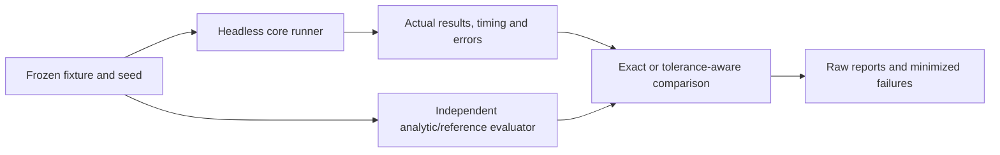

# Independent oracles fixtures and failure harness

50,000 intersections, approximately 150,000 directed segments, <=200,000 turn states and <=600,000 transitions. Base/peak/closure profiles and a frozen 60% cross-district, 20% local, 10% closure-affected, 10% disconnected pair mix.

Independent Dijkstra reads raw roads and incoming-segment state, not the expanded hierarchy. Small graphs add all-pairs dynamic-programming checks. Recompute every route from original segment IDs; equal-cost legal ties may differ in path.

Preprocessing <=10 minutes and <=2 GiB; full customization <=10 seconds/profile; >=100 accelerated full routes/s for 60 seconds with p95 <=500 ms; median core-search speedup >=3x on 1,000 frozen long-distance pairs. Exactness: 10,000 cases and 200 small graphs.

Faults exercise only owned files/processes. Interrupt staged artifact publication and challenge corrupt/incompatible files. Quotas stop work explicitly. Independent tests cover known bad outputs so an oracle cannot pass merely by sharing the same bug. Reports retain commands, configuration, seed/build, actual measurements, raw counterexamples and limitations. All execution results are NOT RUN.
